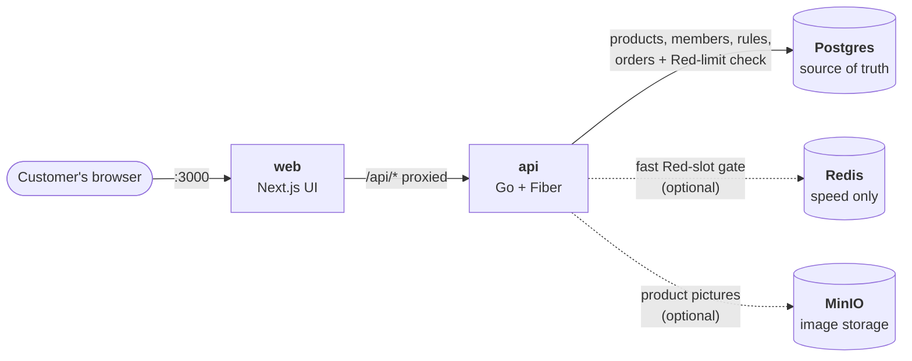
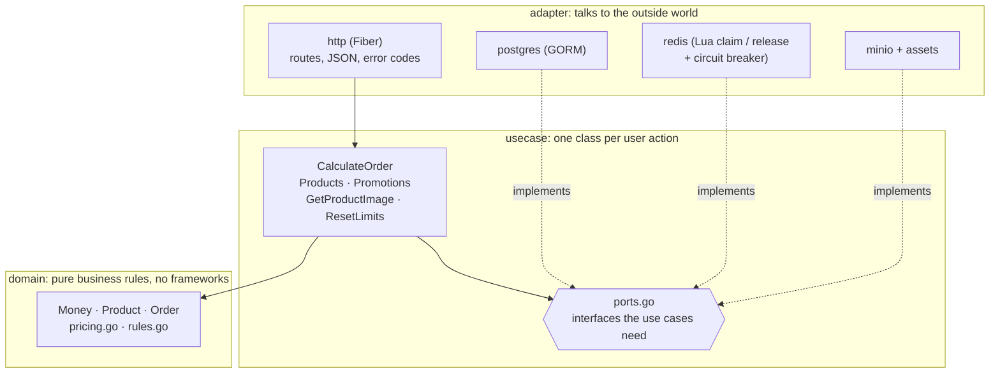
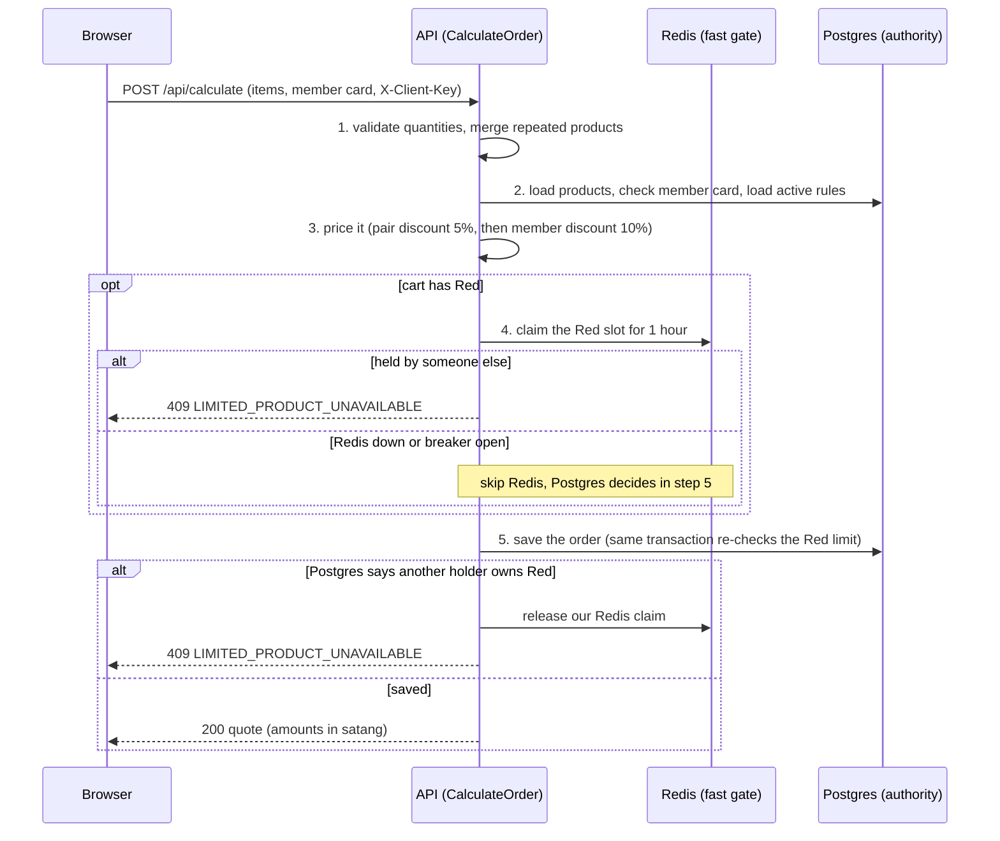
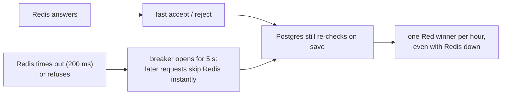

# Food Store Calculator

A price calculator for a food store with 7 menu items. A **Go (Fiber) API** prices orders with
pair and member discounts and enforces the "one Red order per hour" limit. A
**Next.js UI** lets a customer pick quantities, enter a member card and see the breakdown.
Postgres (via GORM) holds products, members, discount rules and orders and is the authority on the Red-set limit; Redis is a fast gate in front of it;
MinIO holds the product pictures.

## Prerequisites

- Docker with Compose (everything runs in containers).
- Only for local development outside Docker: Go 1.26 (Go downloads it automatically) and Node 22+.

## Run it

```bash
cp .env.example .env     # first time only; set POSTGRES_PASSWORD (and ports if you need)
docker compose up --build
```

| What | URL |
|---|---|
| Web UI | http://localhost:3000 (`WEB_HOST_PORT`) |
| API (direct) | http://localhost:18080 (`API_HOST_PORT`; the container itself uses 8080, and 18080 avoids clashing with other local services) |
| Postgres | `localhost:55432` (`POSTGRES_HOST_PORT`), user, password and database from your `.env` |
| MinIO console | http://localhost:19001 (`MINIO_CONSOLE_HOST_PORT`), login from `MINIO_ROOT_USER` / `MINIO_ROOT_PASSWORD` in your `.env` |
| MinIO S3 API | `localhost:19000` (`MINIO_API_HOST_PORT`) |

Stop with `Ctrl+C`. Postgres, Redis and MinIO keep their data in named Docker volumes (`postgres-data`, `redis-data`, `minio-data`), so orders, a held Red slot and uploaded pictures survive a stop and restart, even `docker compose down`. For a clean start run `docker compose down -v`. (If you ran an older version of this compose file, its Postgres data lived in an anonymous volume and is not picked up by `postgres-data`; the database is re-created and re-seeded.)

### Demo member cards

| Card | Status |
|---|---|
| `MEM0001` | active: gets 10% off |
| `MEM0002` | suspended: rejected with "Member card not found." |

Cards are case-insensitive and surrounding spaces are ignored.

### Try the Red set rule

1. Open http://localhost:3000, add a Red set and press Calculate: it works, and Red is now recorded as ordered for 1 hour.
2. Calculate again with Red in the cart from a **different** browser or a private window: it is rejected, because Red was already ordered within the hour. Orders without Red still work.
3. The browser that holds the Red claim can still press Recalculate and price Red again: the page sends a random per-session key (`X-Client-Key`, kept in `sessionStorage`) and the API treats the same key as the same holder. Without the key (for example plain `curl`) every request is a different holder.

If saving the order fails, the Red claim made by that request is released, so the customer can retry.

To reset the window, set `ENABLE_TEST_TOOLS=true` in `.env` (default is `false`) and use the "Reset Red set limit" button. Flushing Redis alone no longer resets the window, because Postgres is authoritative.

## Configuration (`.env`)

All settings come from environment variables. Each place that reads them has a committed
`.env.example` to copy; the real `.env` files are git-ignored, so secrets are never committed.

| File | Used by | Key settings |
|---|---|---|
| `.env` (from `.env.example`) | `docker compose` | `POSTGRES_PASSWORD` (required), `POSTGRES_USER`, `POSTGRES_DB`, `POSTGRES_HOST_PORT`, `API_HOST_PORT`, `WEB_HOST_PORT`, `MINIO_ROOT_USER`, `MINIO_ROOT_PASSWORD` (required), `MINIO_BUCKET`, `MINIO_API_HOST_PORT`, `MINIO_CONSOLE_HOST_PORT`, `ENABLE_TEST_TOOLS` |
| `backend/.env` (from `backend/.env.example`) | the API when run outside Docker (`go run ./cmd/server`) | `DATABASE_URL` (required), `REDIS_ADDR`, `REDIS_DB` (0-15, default 0), `PORT`, `MINIO_ENDPOINT` / `MINIO_ACCESS_KEY` / `MINIO_SECRET_KEY` / `MINIO_BUCKET` / `MINIO_USE_SSL` (optional; leave `MINIO_ENDPOINT` empty for no pictures), `ENABLE_TEST_TOOLS` |
| `frontend/.env` (from `frontend/.env.example`) | `npm run dev` / `npm run build` | `API_URL`, `ENABLE_TEST_TOOLS` |

Real environment variables always win over a `.env` file, and a missing `.env` is fine when the
variables are set another way (CI, production). Docker images never contain `.env` files.
`ENABLE_TEST_TOOLS` defaults to `false` in every `.env.example`. Set it to `true` to expose a test-only
"reset the Red set limit" endpoint and button for a demo; keep it `false` anywhere real customers can reach.

## Product pictures (MinIO)

Each product card shows a picture. Pictures live in MinIO (S3-compatible storage); the database only
stores the file name in `products.image_key`. Products without a picture show a built-in "no image"
picture, and so does any product whose picture cannot be loaded.

**Add a picture**

1. Open the MinIO console at http://localhost:19001 and sign in with `MINIO_ROOT_USER` / `MINIO_ROOT_PASSWORD` from your `.env`.
2. Open the bucket `product-images` (the API creates it on start) and upload a PNG, JPEG, WebP or GIF of at most 5 MB, for example `red.png`.
3. Point the product at it (in DBeaver or `psql`):

   ```sql
   update products set image_key = 'red.png' where id = 'red';
   ```

   Refresh the page. To remove a picture, set `image_key = NULL`.

**What the user sees when something is wrong**

| Situation | Result |
|---|---|
| Product has no `image_key` | default "no image" picture |
| File missing in MinIO, or not a PNG/JPEG/WebP/GIF, or over 5 MB | default picture (SVG and HTML files are refused on purpose: they can carry scripts) |
| MinIO stopped or unreachable | default picture; the menu and prices keep working. The first request waits up to 3 seconds, then the API skips MinIO for 10 seconds so pictures do not each wait; it recovers by itself |
| The browser cannot reach the API | the page falls back to `/no-image.svg`, served by the web app |

The browser never talks to MinIO: it asks the API (`GET /api/products/{id}/image`), so MinIO stays private
inside Docker. The default picture is compiled into the API (`internal/adapter/assets/no-image.svg`) and
copied to `frontend/public/no-image.svg`; if you change one, change both.

## Architecture at a glance

### 1. The big picture (what runs in Docker)



| Piece | Job | If it is down |
|---|---|---|
| **web** | Shows the menu, cart and price breakdown | Nothing works (it is the UI) |
| **api** | Prices orders and enforces the rules | UI cannot calculate |
| **Postgres** | Stores everything and makes the final Red-limit decision | `/readyz` returns 503, API cannot price |
| **Redis** | Fast first check for the Red slot | **Nothing breaks**: Postgres decides alone, `/readyz` says `degraded` |
| **MinIO** | Stores product pictures | **Nothing breaks**: the API serves a built-in "no image" picture |

The browser only ever talks to **web** (and through it **api**). It never talks to the databases or MinIO.

### 2. Inside the API (Clean Architecture)



**Rule of thumb:** arrows point inward. `adapter -> usecase -> domain`. The domain knows nothing about HTTP,
Postgres or Redis, so the pricing rules can be tested with plain Go tests, and a database can be swapped by
writing a new adapter.

### 3. What happens when you press "Calculate"



### 4. When Redis fails



### 5. Where the code lives

```
Browser -> frontend/src/features/calculator   (cart UI, API client)
        -> backend/internal/adapter/http      (route + JSON)
        -> backend/internal/usecase           (CalculateOrder: the workflow)
        -> backend/internal/domain            (pricing + discount rules)
        -> adapter/postgres | adapter/redis | adapter/minio   (storage)
```

## Red-limit consistency model

- **Postgres is authoritative.** The order save runs the Red check inside its own transaction: it locks the active `product_limits` row, looks up who opened the current window (`order_items.started_limit_window`, holder = `orders.client_key` or the order id) and rejects a different holder with 409. A repeat order by the same holder is allowed and never extends the window.
- **Redis is a fast admission gate** in front of it. It answers most conflicts without a database transaction. If the gate admits a request that Postgres then rejects (Redis lost its data, or was down when the winner ordered), the Redis claim is released.
- **A circuit breaker** (200 ms command timeout, 5 s cooldown) stops requests from waiting on a dead Redis. While Redis is unavailable the request skips it and Postgres alone decides, so there is no outage window in which two buyers can both win.
- **`/readyz`** reports `degraded` (HTTP 200) when only Redis is down, so the API stays in rotation.
- Trade-offs: the app clock and Redis TTL can differ slightly, so after an outage Redis may block the same holder a little longer than Postgres would; a leftover Redis key with no matching order over-blocks until its TTL expires (it never double-sells); under the database path concurrent Red orders are serialized by the row lock; `OrderRepository.Save` now enforces limits (documented on the port).

## Pricing rules (from the task)

| Rule | Behavior |
|---|---|
| Pair discount | Each pair of the **same** colour among Orange, Pink or Green gets 5% off that pair. Pink x4 = two discounted pairs; Green x3 = one discounted pair + one full-price set. |
| Member discount | A valid member card gives 10% off the total **after** pair discounts. |
| Red set | If a Red set was ordered in the last hour, further Red orders are rejected for everyone else until the hour is over. |

Money is handled as integer satang (1/100 THB) to avoid float errors; discounts round half-up.

## API

All errors look like `{"error":{"code":"...","message":"..."}}`.

| Method | Path | Purpose |
|---|---|---|
| GET | `/healthz` | liveness only: the process is up; it never touches Postgres or Redis |
| GET | `/readyz` | readiness: Postgres must answer. 200 `{"status":"ok"}`; 200 `{"status":"degraded"}` when only Redis is down (the Postgres guard still enforces the Red rule); 503 `{"status":"unavailable"}` when Postgres is down (no details). Used by the API's Docker healthcheck. MinIO is not checked because pictures fall back to the default |
| GET | `/api/products` | the menu: `[{ "id", "name", "priceSatang", "imageUrl" }]` |
| GET | `/api/products/{id}/image` | the product picture, or the built-in "no image" picture when there is none or it cannot be loaded (always 200 for a known product) |
| GET | `/api/promotions` | the active rules (`[{ code, type, percent, bundleSize?, productIds? }]`); the UI reads badges and percents from here, so rule changes need no frontend change |
| POST | `/api/calculate` | price an order. Needs `Content-Type: application/json` (otherwise 415). Optional header `X-Client-Key` (max 128 characters) identifies the caller for the Red rule |
| POST | `/api/test/reset-limits` | test aid, only when `ENABLE_TEST_TOOLS=true`: frees the Red set so the one-per-hour rule can be retried (the UI shows a "Reset Red set limit" button when the web container has the same flag) |

Request:

```json
{ "memberCard": "MEM0001", "items": [{ "productId": "orange", "quantity": 2 }] }
```

Response (amounts in satang):

```json
{
  "items": [{ "productId": "orange", "name": "Orange set", "quantity": 2, "unitPriceSatang": 12000, "lineTotalSatang": 24000 }],
  "totalBeforeSatang": 24000,
  "itemDiscounts": [{ "ruleCode": "PAIR_5", "productId": "orange", "name": "Orange set", "bundles": 1, "amountSatang": 1200 }],
  "memberDiscountSatang": 2280,
  "finalTotalSatang": 20520
}
```

| Status | Code | When |
|---|---|---|
| 400 | `INVALID_REQUEST` | empty order, unknown product, quantity not 1-1000, malformed JSON, oversized `X-Client-Key`. The message is always the same generic text; the detail is logged, not returned |
| 400 | `INVALID_MEMBER_CARD` | card not found or suspended |
| 409 | `LIMITED_PRODUCT_UNAVAILABLE` | Red was already ordered within the last hour by someone else (a different client key) |
| 415 | `UNSUPPORTED_MEDIA_TYPE` | `POST /api/calculate` without a JSON `Content-Type` |
| 500 | `INTERNAL` | unexpected failure (details are logged, never returned) |


## Run the tests

Backend (unit tests need nothing else):

```bash
cd backend
go test -race -cover $(go list -f '{{if or .TestGoFiles .XTestGoFiles}}{{.ImportPath}}{{end}}' ./...)
```

(Plain `go test -race -cover ./...` fails on some toolchains with `go: no such tool "covdata"` for the
packages that have no tests, `cmd/server`, `platform/db` and `migrations`; the command above lists only
packages that have tests. CI uses the same list with `-coverprofile`.)

To include the Postgres integration tests, start Postgres and point `DATABASE_URL` at it. The tests never touch the database that URL names: they drop and recreate their own `<name>_test` database on the same server (for example `foodstore_test`), so your data and any experiments in a SQL client are safe:

```bash
docker compose up -d postgres
DATABASE_URL='postgres://postgres:<POSTGRES_PASSWORD from .env>@localhost:55432/foodstore?sslmode=disable' \
  go test -race -cover $(go list -f '{{if or .TestGoFiles .XTestGoFiles}}{{.ImportPath}}{{end}}' ./...)
```

To also run the MinIO adapter tests, start MinIO and give them its address (they skip when unset):

```bash
docker compose up -d minio
MINIO_TEST_ENDPOINT=localhost:19000 MINIO_TEST_ACCESS_KEY=<MINIO_ROOT_USER> MINIO_TEST_SECRET_KEY=<MINIO_ROOT_PASSWORD> go test -race ./internal/adapter/minio/
```

With Postgres and MinIO running, the backend reaches about 94% statement coverage; without them the
integration tests skip and it is about 74%. The frontend has 68 Vitest tests (no coverage tool is
configured).

Frontend:

```bash
cd frontend
npm ci
npm test            # component and logic tests (Vitest + Testing Library)
npm run typecheck
npm run lint
```

## Project structure

```
backend/                 Go, Clean Architecture
  cmd/server/            composition root: wires everything together
  internal/domain/       entities, Money, pricing rules (stdlib only)
  internal/usecase/      CalculateOrder, Products, Promotions, GetProductImage, ResetLimits + the ports they need (ports.go)
  internal/adapter/      http (Fiber) · postgres (GORM; the order save enforces the Red limit) · redis (Lua claim / release with a circuit breaker) · minio (pictures) · assets (built-in no-image picture)
  internal/platform/     config, database connection and migrations
  internal/e2e/          end-to-end tests of the Red rule with Redis up and down
  migrations/            SQL schema and seed data
frontend/                Next.js 16 App Router, TypeScript
  src/app/               page (streamed menu), error boundary
  src/features/calculator/  API client, reducer, hook, components
docs/                    design spec, implementation plan, interview notes
.github/workflows/       CI: gofmt, vet, race tests with Postgres and Redis, frontend checks, Docker builds
```

Dependency rule: `adapter -> usecase -> domain`. The domain never imports a framework, a database
driver or the use cases.

More: [design spec](docs/superpowers/specs/2026-10-16-food-store-calculator-design.md) ·
[implementation plan](docs/superpowers/plans/2026-10-16-food-store-calculator.md) ·
[interview walkthrough](docs/INTERVIEW.md)
